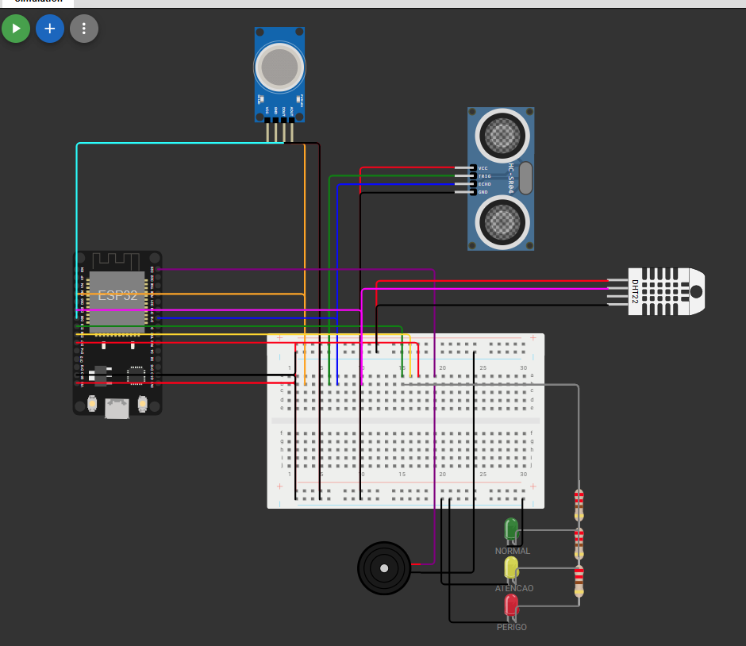

# Alaga Alerta — Sensor de nível de água em bueiro (Maker Lab)

> Global Solution FIAP 2026.2 · CitizenTech · Disciplina 7 de 7: **Project-Based Maker Lab** (componente *Físico*)

Dispositivo embarcado (ESP32, simulado no Wokwi) que fica no topo de um bueiro ou córrego e **mede o nível da água** com um sensor de proximidade (HC-SR04), além do **gás acumulado** (MQ-2) e da **temperatura e umidade** do local (DHT22). Uma **árvore de decisão embarcada (TinyML)** olha o nível e a **velocidade de subida** e classifica o risco em `NORMAL`, `ATENCAO` ou `PERIGO`. O alerta sai na hora por **LED e buzzer** (sem depender de rede) e as leituras seguem em JSON por HTTPS para a **API central do Alaga Alerta** (`POST /leituras`), com fila e reenvio se a rede cair.

## Integrantes

| Nome | RM |
|---|---|
| Manoella Herrerias Waideman | 98906 |
| Felipe Capriotti da Silva Santos | 98460 |
| Victor Hugo Andrade | 550996 |
| Gustavo Kawamura Christofani | 99679 |

## Links

| Item | Link |
|---|---|
| Simulação no Wokwi | _colar o link do projeto no Wokwi_ |
| Vídeo demonstrativo (até 6 min) |https://youtu.be/r_vE-ALpE9w |
| Repositório do produto (MVP) | http://68.211.147.178/|

---

## 1. Problema (CitizenTech)

Moradores e motoristas de bairros com histórico de alagamento (o exemplo do protótipo é a Vila Maria, em São Paulo) recebem alertas de chuva genéricos, que chegam tarde para quem precisa decidir se sai de casa ou desvia de uma rua. Falta um dado **local e em tempo real** de quanto a água já subiu e com que velocidade.

O **Alaga Alerta** avisa por bairro, em tempo útil, quando uma rua está prestes a alagar. Este dispositivo é a ponta física dessa cadeia: ele mede o nível no próprio bueiro e alimenta a API central, de onde o MVP mostra o mapa do bairro e o RPA dispara o aviso quando a classe chega a `PERIGO`.

ODS atendidos: **11** (cidades sustentáveis) e **13** (ação climática), com **3** e **9** como secundários.

## 2. Sensores, atuadores e papel de cada um

| Componente | Função | Pino (ESP32) | Observação |
|---|---|---|---|
| **HC-SR04** (proximidade) | **Sensor principal e adicional:** mede a distância até a superfície da água; nível = altura do bueiro − distância. É o dado da IA | TRIG 19 · ECHO 18 | Fica no topo, apontado para baixo (`ALTURA_BUEIRO_CM` = 150). No sensor real, o ECHO é 5 V e precisa de divisor de tensão |
| **MQ-2** (gás) | Gás acumulado no bueiro (segundo risco). Entra como contexto e sobe `NORMAL` para `ATENCAO` | AOUT 34 · DOUT 33 | Só o AOUT é usado. Sem calibração: valor em % da escala (0 a 100), não em ppm |
| **DHT22** (temperatura e umidade) | Contexto do local, enviado no JSON | 32 | Leitura por driver próprio, sem biblioteca. No sensor real, use `DHT_TIPO 11` |
| LED verde / amarelo / vermelho | `NORMAL` / `ATENCAO` / `PERIGO` | 25 / 26 / 27 | Resistores de 220 Ω. Seguem a classe da última janela |
| Buzzer | `ATENCAO`: 2 bipes curtos · `PERIGO`: 3 bipes longos | 23 | Toca quando o alerta é confirmado |

A montagem completa (protoboard half, alimentação e ligações) está em `wokwi/diagram.json`, que é a fonte de verdade. No simulador, o nível é controlado pelo slider de distância do HC-SR04 (padrão: 66 cm, o que dá nível de 84 cm, ou 56%).



## 3. Como a IA funciona

**Pipeline:** sensor → janela de 10 leituras → atributos → árvore de decisão → classe → confirmação por histerese → alerta.

- **Entrada:** janela de 10 leituras do nível da água (% da altura do bueiro), uma a cada 500 ms (5 s por janela).
- **Atributos:** `f[0]` nível médio (%), `f[1]` taxa de subida (%/min, regressão linear) e `f[2]` nível máximo (%). A mesma conta está em `wokwi/sketch.ino`, `wokwi/features.h` e `ml/train_classifier.py`.
- **Classes:** `NORMAL`, `ATENCAO`, `PERIGO`.
- **Modelo:** árvore de decisão (scikit-learn, profundidade 5, 23 nós) exportada como `if/else` em C por `ml/train_classifier.py` (`wokwi/classifier.h`). O mesmo código está embutido no `sketch.ino`, porque o Wokwi trabalha com arquivo único.
- **Por que IA e não um limiar:** a taxa de subida. Um nível médio que sobe rápido é mais perigoso que o mesmo nível parado, e um simples `if nivel > X` não enxerga isso. Com o nível subindo 20 %/min, por exemplo, o modelo já indica `PERIGO` perto dos 30% de nível, enquanto com a água parada isso só acontece a partir de uns 70%.
- **Decisão com histerese:** 3 janelas consecutivas da mesma classe de risco (15 s) confirmam o alerta, o que evita falso alarme por onda ou ruído. Mudar de classe reinicia a contagem. A mesma classe não é reenviada em menos de 20 s (cooldown), mas a subida de `ATENCAO` para `PERIGO` sai na hora.
- **Regra do gás:** se a média do MQ-2 na janela for ≥ 60% da escala e a classe for `NORMAL`, ela sobe para `ATENCAO` (`motivo: "gas"`). Se o nível já está em risco, a classe não muda e o motivo vira `"nivel+gas"`. O gás **não** entra no modelo.
- **Rotulagem dos dados sintéticos** (hipóteses de projeto; n = nível médio em %, r = taxa em %/min):
  - `PERIGO`: n ≥ 70, ou (n ≥ 45 e r ≥ 8), ou (n ≥ 30 e r ≥ 16).
  - `ATENCAO`: n ≥ 40, ou (n ≥ 20 e r ≥ 4), ou (n ≥ 10 e r ≥ 10).
  - `NORMAL`: o resto.
- **Métricas:** ver `docs/metricas_classificador.txt` (acurácia de cerca de 98,5% no teste sintético).

### Limitações

1. Os dados de treino são **sintéticos** e os rótulos vêm de regras de projeto. A acurácia mede o quanto a árvore aprendeu essas regras, **não** o desempenho em campo.
2. A árvore aproxima as regras e pode divergir delas perto dos limites entre classes.
3. Os limiares (por exemplo, `PERIGO` a partir de 70% do nível e gás alto a partir de 60% da escala) são **hipóteses de projeto**. Falta validar com a Defesa Civil ou o CGE antes de tratá-los como critério técnico.
4. O MQ-2 não é calibrado: `gas_pct` é % da escala analógica, não ppm.
5. A escala de tempo é de **demonstração**: a janela de 5 s e a taxa em %/min foram pensadas para o vídeo. Em campo a subida de um bueiro é bem mais lenta, e os parâmetros precisariam ser recalibrados.
6. O Wokwi simula o nível pelo slider do HC-SR04. No sensor real, falta definir altura, fixação e proteção do sensor contra a água.
7. O ponto de instalação (Vila Maria, `-23.5214, -46.5878`) é um **exemplo**. Troque pelo bueiro ou córrego real do bairro escolhido.

## 4. Integração com o Alaga Alerta

```
HC-SR04 (nível) ┐
MQ-2 (gás)      ├─▶ ESP32 ─▶ janela de 10 leituras ─▶ árvore de decisão (TinyML)
DHT22 (contexto)┘                                              │
                                              histerese (3 janelas) + cooldown
                                          ┌────────────────────┴──────────────┐
                                  LED + buzzer (local)             HTTPS POST (JSON)
                                                                              │
                                                              API central ─▶ MVP (mapa) · RPA (aviso)
```

**Endpoint:** `POST /leituras` · **Cabeçalhos:** `Content-Type: application/json`, `X-Device-Id`, `X-Device-Key`.

```json
{
  "sensor_id": "alaga-sensor-01",
  "event_id": "alaga-sensor-01-12",
  "ts": "2026-11-13T21:15:03Z",
  "tipo": "alerta",
  "bairro": "Vila Maria",
  "lat": -23.52140, "lon": -46.58780,
  "classe": "PERIGO",
  "nivel_cm": 112.0, "nivel_pct": 74.7, "taxa_pct_min": 9.3,
  "gas_pct": 12, "gas_alto": false, "motivo": "nivel",
  "janelas_confirmadas": 3,
  "temperatura_c": 22.1, "umidade_pct": 88,
  "fonte": "sensor"
}
```

| Campo | Significado |
|---|---|
| `tipo` | `alerta` (`ATENCAO` ou `PERIGO` confirmado) ou `leitura` (rotina com tudo `NORMAL`, a cada 30 s) |
| `motivo` | `nivel`, `gas` ou `nivel+gas` |
| `fonte` | `sensor` (HC-SR04 do Wokwi) ou `teste` (perfis de `FONTE_NIVEL` de 1 a 5) |
| `event_id` | Igual no reenvio, para a API descartar duplicados |
| `lat`, `lon`, `bairro` | Posição fixa do ponto cadastrado do sensor (não é rota simulada) |
| `temperatura_c`, `umidade_pct` | `null` se o DHT nunca teve uma leitura válida |

**Quem consome:** a API central grava, o MVP mostra a leitura no mapa do bairro e o RPA usa `classe == "PERIGO"` como gatilho de aviso. Este contrato é uma **proposta do dispositivo**: se a API do MVP esperar outros nomes de campo, basta ajustar `buildPayload()` em `wokwi/sketch.ino`.

**Tolerância a falhas:**
- O alerta local (LED e buzzer) acontece **antes** do envio e não depende de rede.
- Se o POST falhar (sem Wi-Fi, API fora do ar ou HTTP fora de 2xx), o alerta entra numa fila de 8 itens na RAM e é reenviado quando a rede voltar (`enqueue()` / `flushQueue()`). Com a fila cheia, o mais antigo é descartado e o Serial avisa.
- O Wi-Fi tenta reconectar a cada 10 s.
- Sem eco do HC-SR04, a amostra é ignorada e não entra na classificação.
- Se o DHT falhar, o sketch mantém a última leitura válida.

**Links de integração:** MVP e repositório principal estão na tabela de links no topo.

## 5. Como executar no Wokwi

1. Crie um projeto **ESP32** (Arduino) em [wokwi.com](https://wokwi.com).
2. Substitua o `diagram.json` por `wokwi/diagram.json`.
3. Cole `wokwi/sketch.ino` na aba principal (arquivo único, sem bibliotecas externas).
4. Troque `API_URL` por um endereço de teste em [webhook.site](https://webhook.site) (ou pela API real, rota `POST /leituras`).
5. Clique em ▶ e abra o Serial Monitor. Arraste o slider de distância do HC-SR04 para mudar o nível da água.

Para testar sem mexer no sensor, mude `FONTE_NIVEL` no topo do sketch: `0` sensores do Wokwi · `1` NORMAL · `2` ATENCAO · `3` PERIGO · `4` subida rápida · `5` gás alto com nível normal.

Se o DHT só mostrar `[dht] leitura inválida`, ponha `DHT_USAR_BIBLIOTECA 1` e crie a aba `libraries.txt` com as linhas `DHT sensor library` e `Adafruit Unified Sensor`.

## 6. Reproduzir o treino e os testes em PC

```bash
pip install scikit-learn numpy
python ml/train_classifier.py
g++ -std=c++17 -I wokwi ml/tests/host_test.cpp -o /tmp/host_test
/tmp/host_test ml/tests/parity_vectors.txt
```

O treino regenera `wokwi/classifier.h`, `docs/metricas_classificador.txt` e `ml/tests/parity_vectors.txt`. O teste confere que o C++ dá a mesma classe que o Python (última execução: 300 de 300 vetores iguais). Depois de treinar de novo, copie o corpo de `classifyWindow` de `wokwi/classifier.h` para o `sketch.ino`.

## 7. Plano de testes

> **Como os resultados foram obtidos:** o próprio `wokwi/sketch.ino` foi compilado em PC com stubs de Arduino, relógio simulado e sensores controlados por script (`ml/tests/sim/`, rodar com `bash ml/tests/sim/run.sh <n>`). A coluna "Resultado" é a saída real desse firmware (Serial, LEDs, buzzer e POST). **Não é uma execução no Wokwi**: o simulador pode diferir em detalhes de tempo e do DHT. Os tempos (t) contam a partir do `setup()`.

| # | Condição | Como provocar | Resultado |
|---|---|---|---|
| 1 | Bueiro vazio | Distância do HC-SR04 ≥ 150 cm | `NORMAL` (0%), LED verde, sem alerta. Leituras de rotina (`tipo: leitura`, HTTP 200) em t = 5, 35 e 65 s |
| 2 | Nível médio | Distância ≈ 66 cm (nível 84 cm = 56%), parado | Em t = 5 s: `ATENCAO`, LED amarelo. Alerta confirmado em t = 15 s (3 janelas): 2 bipes e POST `tipo: alerta`, HTTP 200 |
| 3 | Nível alto | Distância ≈ 30 cm (nível 120 cm = 80%) | Em t = 5 s: `PERIGO`, LED vermelho. Confirmado em t ≈ 16,6 s: 3 bipes longos e POST, HTTP 200 |
| 4 | Subida rápida | `FONTE_NIVEL 4` (sobe 0,5 cm/s, ≈ 20 %/min) | `ATENCAO` já na 1ª janela (14% de nível), alerta em t ≈ 15 s. `PERIGO` na janela de t = 55 s, com 31% de nível e 18 %/min, bem antes dos ≈ 70% exigidos com a água parada |
| 5 | Onda passageira | 150 cm → 30 cm por 10 s → 150 cm | Só 2 janelas de `PERIGO` (LED vermelho por ≈ 10 s) e volta a `NORMAL`: **sem bipe e sem POST de alerta** (histerese). A janela de transição mostra uma taxa artificial, porque o slider salta de uma vez |
| 6 | Gás alto, nível normal | `FONTE_NIVEL 5` (gás ≈ 85%, nível 10%) | `ATENCAO` com `motivo: "gas"`, `gas_alto: true`, `fonte: "teste"`. Confirmado em t ≈ 15 s |
| 7 | Gás alto e nível em risco | Distância 30 cm e gás ≈ 85% | Classe do nível mantida (`PERIGO`), `motivo: "nivel+gas"`. Confirmado em t ≈ 16,6 s |
| 8 | Alerta persistente | `PERIGO` mantido por 75 s | POST em t ≈ 16,6 s e t ≈ 47,6 s. As confirmações de t ≈ 31 s e 62 s caem no cooldown (`[alerta] já reportado há pouco`). Na prática o reenvio sai a cada ≈ 31 s (confirmações a cada 15 s + cooldown de 20 s) |
| 9 | Mudança de classe | 66 cm por 30 s, depois 30 cm | `ATENCAO` confirmado em t ≈ 15 s. Após a subida, `PERIGO` é confirmado em t ≈ 41,6 s, sem esperar o cooldown, mas só depois de 3 janelas da nova classe |
| 10 | Umidade alta | DHT22 em 87,5% / 22,1 °C (padrão do diagrama) | JSON com `"temperatura_c":22.1,"umidade_pct":88`. O DHT é só contexto e não muda a classe |
| 11 | **Falha:** API fora do ar | POST com erro (`HTTP -1`) | `[api] falha — guardando na fila`, `[fila] 1 pendente(s)`. LED, buzzer e monitoramento continuam |
| 12 | **Falha:** sem Wi-Fi | Wi-Fi derrubado após o início | Alerta local normal (LED e buzzer). A fila cresce a cada alerta (`1 pendente(s)` em t ≈ 16,6 s, `2 pendente(s)` em t ≈ 47,6 s), até o máximo de 8 |
| 13 | **Falha:** API volta | API volta e o nível cai para `NORMAL` | Na 1ª janela `NORMAL` (t ≈ 46 s): `[fila] reenviada, restam 0` (mesmo `event_id`) e depois a leitura de rotina |
| 14 | **Falha:** HC-SR04 sem eco | Sensor fora de alcance | `[sensor] HC-SR04 sem eco — amostra ignorada` a cada ≈ 5 s. Nenhuma janela é completada e nada é classificado nem enviado |
| 15 | **Falha:** DHT sem leitura | DHT para de responder | `[dht] leitura inválida — mantendo a anterior` a cada 3 s. O JSON continua com a última leitura válida (22.1 / 88). Se o DHT **nunca** leu, o JSON sai com `"temperatura_c":null,"umidade_pct":null` |

## 8. Segurança e LGPD

- Nenhum dado pessoal trafega pelo sensor: só nível, gás, temperatura, umidade, hora e a posição do ponto de instalação.
- `DEVICE_KEY` (`dev-key-demo`) é **placeholder, não é segredo**. Chave real nunca vai para o git (o `.gitignore` já ignora `wokwi/secrets.h` e `*.env`).
- `setInsecure()` no HTTPS é só para a demo no simulador. Em produção, validar o certificado com `setCACert()`.

## 9. Estrutura do repositório

```
README.md
wokwi/   sketch.ino (arquivo único) · diagram.json · features.h · classifier.h (gerado)
ml/      train_classifier.py · tests/ (host_test.cpp + parity_vectors.txt: paridade Python x C++;
         sim/: roda o sketch.ino em PC para o plano de testes)
docs/    metricas_classificador.txt (gerado)
assets/  image.png (foto do circuito)
```
